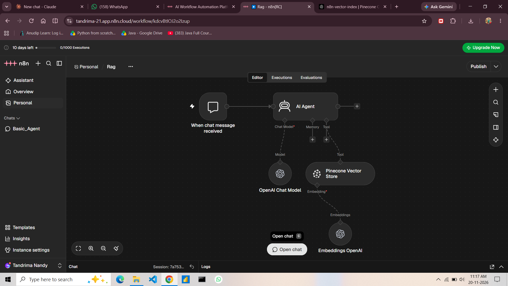
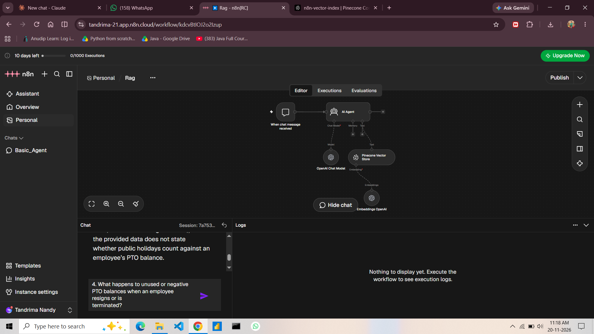
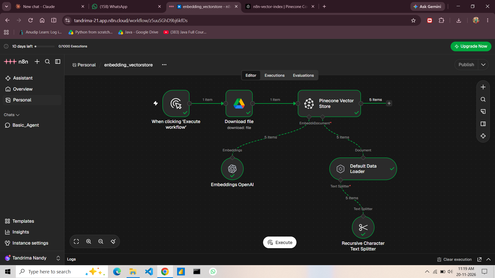
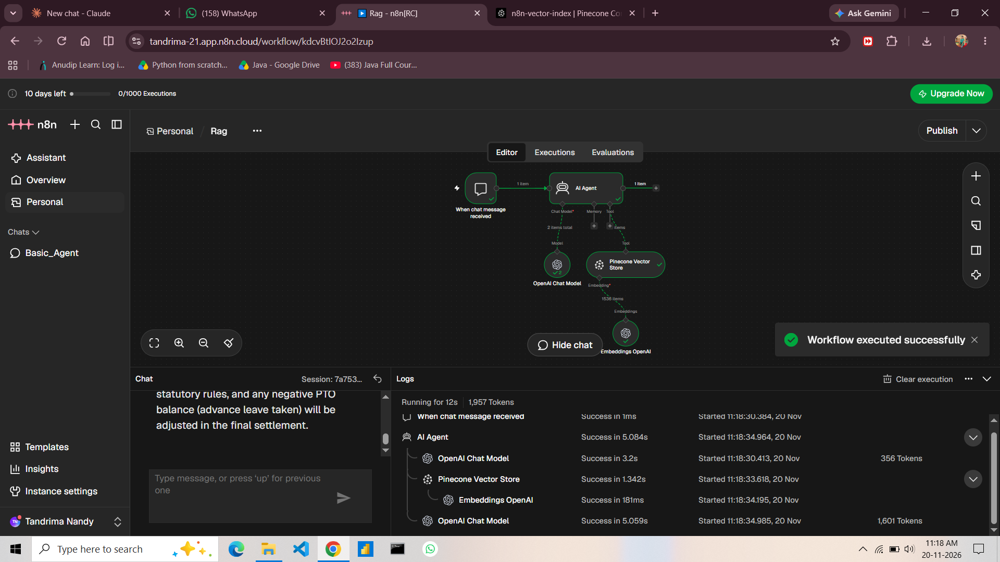

<div align="center">

# Tandrima Nandy — Portfolio

**Software Developer | AI & Data Enthusiast | Cloud Learner**

*"Building intelligent solutions where Code, Data & AI meet."*

<br>

<table>
  <tr>
    <td width="33%" align="center" valign="top">
      <a href="https://my-portfolio-tandrima.vercel.app">
        <h3>🌐 Live Site</h3>
        <sub>Open the portfolio in your browser</sub>
      </a>
    </td>
    <td width="33%" align="center" valign="top">
      <a href="#featured-projects">
        <h3>🚀 Projects</h3>
        <sub>Data Sense AI and Symptom Sense AI</sub>
      </a>
    </td>
    <td width="33%" align="center" valign="top">
      <a href="#rag--n8n-agentic-ai">
        <h3>🤖 RAG Agent</h3>
        <sub>n8n, Pinecone and OpenAI document assistant</sub>
      </a>
    </td>
  </tr>
  <tr>
    <td width="33%" align="center" valign="top">
      <a href="#tech-stack--why-i-chose-it">
        <h3>🛠️ Tech Stack</h3>
        <sub>Why I chose each technology</sub>
      </a>
    </td>
    <td width="33%" align="center" valign="top">
      <a href="#getting-started">
        <h3>🏃 Run Locally</h3>
        <sub>Set up and start the app in VS Code</sub>
      </a>
    </td>
    <td width="33%" align="center" valign="top">
      <a href="#contact">
        <h3>📬 Contact</h3>
        <sub>Send a message or connect on GitHub</sub>
      </a>
    </td>
  </tr>
</table>

<br>

[](https://www.python.org/)
[](https://flask.palletsprojects.com/)
[](https://www.sqlite.org/)
[](https://developer.mozilla.org/en-US/docs/Web/JavaScript)
[](https://developer.mozilla.org/en-US/docs/Web/HTML)
[](https://developer.mozilla.org/en-US/docs/Web/CSS)
[](https://n8n.io/)
[](https://www.pinecone.io/)


[Overview](#overview) · [Features](#features) · [Tech Stack](#tech-stack--why-i-chose-it) · [RAG Agent](#rag--n8n-agentic-ai) · [Getting Started](#getting-started) · [Project Structure](#project-structure) · [Customization](#customization) · [Contact](#contact)

</div>

---

## Overview

This is my personal portfolio, a single-page website built with **Flask** and **SQLite**. It presents my background, skills, projects, AI work, experience, education and certifications in an interactive **"universe" theme**: a live starfield that responds to the mouse, can be zoomed and panned, and sits behind every section.

All content (projects, skills, timeline, certificates) is stored in a SQLite database that is **created and seeded automatically on first run**, so the site works with zero setup beyond installing Flask.

---

## Features

Each card below describes a function of the site.

<table>
  <tr>
    <td width="33%" valign="top">
      <h3>Interactive Universe</h3>
      A canvas starfield with depth layers, twinkling stars and shooting stars. Zoom with the <b>+/−</b> buttons or <b>Ctrl + mouse wheel</b>, and drag empty space to pan.
    </td>
    <td width="33%" valign="top">
      <h3>Skills Constellation</h3>
      Skills are grouped by category (Programming, Web, Database, Data &amp; AI, Cloud &amp; Big Data, Apps &amp; Tools, AI Automation). Click any node to read what I use it for.
    </td>
    <td width="33%" valign="top">
      <h3>Projects Showcase</h3>
      Project cards with description, tech tags, key features, live demo and GitHub links, plus a screenshot gallery with a full-screen lightbox.
    </td>
  </tr>
  <tr>
    <td valign="top">
      <h3>Experience &amp; Education</h3>
      Structured timeline entries for my internship, MCA and BCA, loaded from the database.
    </td>
    <td valign="top">
      <h3>Certifications &amp; Awards</h3>
      Certificates and achievements displayed as cards, including Anthropic, AICTE, TATA/Forage and university recognitions.
    </td>
    <td valign="top">
      <h3>My Journey</h3>
      A clickable route of milestones, from BCA to Software Development, each with a short explanation.
    </td>
  </tr>
  <tr>
    <td valign="top">
      <h3>Contact Form</h3>
      A form that posts to <code>/api/contact</code>. Name, email format and message length are validated on the server before saving to SQLite.
    </td>
    <td valign="top">
      <h3>Admin Inbox</h3>
      Saved messages are viewable as JSON at <code>/admin/messages?key=…</code>, protected by an <code>ADMIN_KEY</code> environment variable.
    </td>
    <td valign="top">
      <h3>Responsive &amp; Accessible</h3>
      Mobile menu, fewer stars on small screens, scroll-reveal animations, and support for <code>prefers-reduced-motion</code>.
    </td>
  </tr>
</table>

---

## Tech Stack & Why I Chose It

Click any card to open the official website of that technology.

<table>
  <tr>
    <td align="center" width="33%" valign="top">
      <a href="https://www.python.org/">
        <br><br>
        <b>Backend language</b>
      </a>
      <br><br>
      My strongest language. It runs the whole server and connects naturally to the data and AI libraries (Pandas, NumPy, NLP) I use in my other projects.
    </td>
    <td align="center" width="33%" valign="top">
      <a href="https://flask.palletsprojects.com/">
        <br><br>
        <b>Web framework</b>
      </a>
      <br><br>
      Lightweight and unopinionated, which is ideal for a portfolio. It gives me routing, templates and a JSON API without extra complexity, and I used it professionally during my internship.
    </td>
    <td align="center" width="33%" valign="top">
      <a href="https://www.sqlite.org/">
        <br><br>
        <b>Database</b>
      </a>
      <br><br>
      Serverless and file-based, so there is nothing to install or host. It auto-creates <code>portfolio.db</code>, and it is more than enough for content and contact messages.
    </td>
  </tr>
  <tr>
    <td align="center" valign="top">
      <a href="https://developer.mozilla.org/en-US/docs/Web/HTML">
        <br><br>
        <b>Structure</b>
      </a>
      <br><br>
      Semantic markup keeps the page accessible and SEO-friendly. Flask's Jinja templates render the database content straight into it.
    </td>
    <td align="center" valign="top">
      <a href="https://developer.mozilla.org/en-US/docs/Web/CSS">
        <br><br>
        <b>Styling</b>
      </a>
      <br><br>
      Custom CSS (variables, grid, flexbox, animations) delivers the dark space theme and responsive layout without relying on a heavy UI framework.
    </td>
    <td align="center" valign="top">
      <a href="https://developer.mozilla.org/en-US/docs/Web/JavaScript">
        <br><br>
        <b>Interactivity</b>
      </a>
      <br><br>
      Vanilla JavaScript powers the canvas starfield, zoom and pan, lightbox, scroll reveals and the contact form (<code>fetch</code>), with no build step and no dependencies.
    </td>
  </tr>
</table>

<div align="center">

**Also used:**
[](https://jinja.palletsprojects.com/)
[](https://developer.mozilla.org/en-US/docs/Web/API/Canvas_API)
[](https://fonts.google.com/)
[](https://code.visualstudio.com/)

</div>

---

## Featured Projects

| Project | Description | Stack | Links |
|---|---|---|---|
| **Data Sense AI** | Analyzes CSV, PDF and Excel datasets: cleans data, generates insights, builds interactive charts and answers questions through an AI chatbot. | Python, Flask, SQLite, Pandas, NumPy, Matplotlib, Plotly | [Live](https://datasensei-iota.vercel.app/login) · [GitHub](https://github.com/Tandrimanandy/Data_sense_ai) |
| **Symptom Sense AI** | Healthcare app that analyzes symptoms, recommends the right specialist and automates appointment booking. | Python, Flask, JavaScript, SQLite, NLP, Pandas, Plotly | [Live](https://elite-hit.vercel.app/login) · [GitHub](https://github.com/Tandrimanandy/Elite--hit) |

---

## RAG & n8n Agentic AI

I built a **RAG (Retrieval-Augmented Generation)** assistant in **n8n**. It loads documents from Google Drive, stores their embeddings in **Pinecone**, and answers questions using only the content it retrieves. I tested it on a PTO (leave) policy document. When a question is not covered by the document, the agent replies *"I don't know based on the provided data."*

### Key concepts

| Concept | How it works in this project |
|---|---|
| **RAG** | The agent searches the document store first, then writes its answer from the retrieved text. |
| **Chunking** | A Recursive Character Text Splitter breaks long documents into smaller pieces so each one can be searched precisely. |
| **Embeddings** | OpenAI's embedding model turns each chunk into a list of 1,536 numbers. Chunks with similar meaning get similar numbers. |
| **Vector database** | Pinecone stores the embeddings in the `n8n-vector-index`, so the agent can find the chunks closest in meaning to a question. |
| **AI Agent** | An n8n AI Agent uses the Pinecone store as a tool and an OpenAI chat model (GPT-5 mini) to write the reply. |
| **Grounded answers** | The agent is instructed to use only retrieved text and never to guess. |

### How the workflow runs

**Ingest a document (run once, or when the document changes)**

```text
Google Drive file → Default Data Loader → Recursive Character Text Splitter → OpenAI Embeddings → Pinecone Vector Store
```

**Answer a question (every chat message)**

```text
Chat message → AI Agent → Pinecone search (tool) → OpenAI Chat Model → Answer
```

### Screenshots

<table>
  <tr>
    <td width="50%" valign="top">
      <br>
      <sub>RAG agent canvas: chat trigger, AI Agent, OpenAI chat model, and Pinecone as a tool</sub>
    </td>
    <td width="50%" valign="top">
      <br>
      <sub>Chat answer: the agent states when the document does not cover a question</sub>
    </td>
  </tr>
  <tr>
    <td width="50%" valign="top">
      <br>
      <sub>Ingestion workflow: Google Drive file loaded into Pinecone</sub>
    </td>
    <td width="50%" valign="top">
      <br>
      <sub>Execution log: the agent workflow running end to end</sub>
    </td>
  </tr>
</table>

**Tech used:** n8n · RAG · Pinecone · OpenAI (Embeddings and Chat Model) · Google Drive · AI Agents

---

## Getting Started

### Prerequisites
- Python 3.9 or newer
- Git (optional)

### Run locally (VS Code)

1. Open this folder in VS Code (**File → Open Folder**).
2. Open the terminal (<kbd>Ctrl</kbd> + <kbd>`</kbd>) and run:

   **Windows**
   ```bash
   python -m venv venv
   venv\Scripts\activate
   pip install -r requirements.txt
   python app.py
   ```

   **macOS / Linux**
   ```bash
   python -m venv venv
   source venv/bin/activate
   pip install -r requirements.txt
   python app.py
   ```
3. Open **http://127.0.0.1:5000** in your browser.

---

## Project Structure

```text
tandrima_portfolio/
├── app.py                 # Flask app, routes, DB schema and seed data
├── requirements.txt       # Python dependencies (Flask)
├── portfolio.db           # SQLite database (auto-created on first run)
├── templates/
│   └── index.html         # Single-page Jinja template
└── static/
    ├── css/style.css      # Theme, layout and animations
    ├── js/main.js         # Starfield, zoom/pan, lightbox, form logic
    └── images/
        ├── profile.jpg            # Portrait (shows "TN" until added)
        ├── data-sense-ai/         # Screenshots for Data Sense AI
        ├── symptom-sense-ai/      # Screenshots for Symptom Sense AI
        └── n8n-agentic-ai/        # Screenshots for the RAG and n8n agent
```

---

## Customization

**Profile photo:** place your portrait at `static/images/profile.jpg`.

**Project screenshots:** put images in `static/images/<project-name-slug>/`. The slug is the project name in lowercase with hyphens (for example `data-sense-ai`). Files are shown in alphabetical order, and the file name becomes the caption (`01-login-page.png` → "Login page").

**Content:** edit the `PROJECTS`, `SKILLS`, `TIMELINE` and `CERTS` lists at the top of `app.py`, delete `portfolio.db`, then rerun the app to reseed.

**RAG & n8n section:** edit the `AI_CONCEPTS` and `AI_FLOWS` lists in `app.py`. Its screenshots live in `static/images/n8n-agentic-ai/`.

**Contact messages:** they are stored in SQLite. View them at:

```text
/admin/messages?key=change-me
```

Set your own key before running:

```bash
# Windows (Command Prompt)
set ADMIN_KEY=your-secret-key

# macOS / Linux
export ADMIN_KEY=your-secret-key
```

> **Warning:** Change the default `change-me` key before deploying anywhere public.

---

## Navigation Tips

- **Zoom:** `+` / `−` buttons or <kbd>Ctrl</kbd> + mouse wheel
- **Pan:** drag on empty space
- **Skills and Journey:** click a node or milestone to read its description

---

## Contact

Have a question or an opportunity? Use the contact form on the website, or reach me through GitHub.

[](https://github.com/Tandrimanandy)

<div align="center">

<sub>Designed and developed by <b>Tandrima Nandy</b></sub>

</div>
